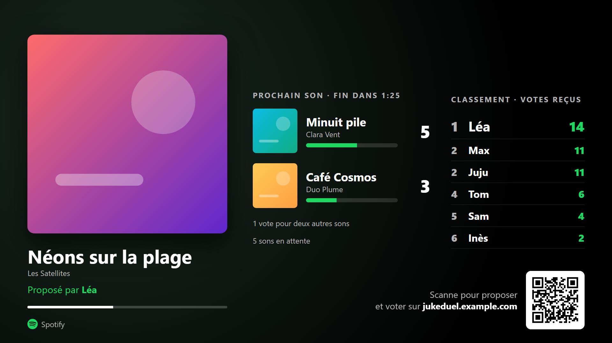
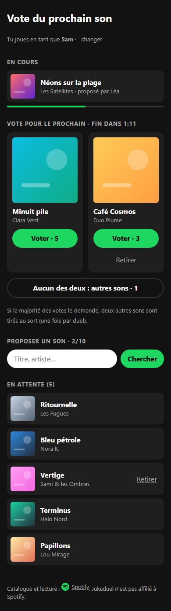
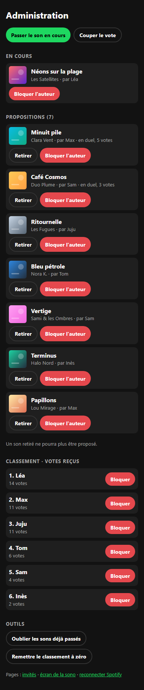

# Jukeduel

Le jukebox de soirée pour Spotify : les invités proposent des sons depuis leur téléphone et votent en duel pour le prochain morceau.



Pendant chaque morceau, deux propositions tirées au hasard s'affrontent. La gagnante est ajoutée à la file d'attente Spotify de l'hôte et passe juste après. Les invités n'installent rien : ils ouvrent un lien.

## Fonctionnalités

- **Le duel.** Le son le plus voté gagne. En cas d'égalité ou sans aucun vote, le hasard tranche. Le perdant retourne dans la liste.
- **« Aucun des deux ».** Si la majorité des votes (au moins 2) le demande, deux autres sons sont tirés au sort. C'est possible une fois par duel.
- **Pseudo et classement.** Chaque invité choisit un pseudo. L'écran classe les invités par votes reçus sur leurs sons, y compris quand ils perdent leur duel. L'auteur d'un son n'est révélé que quand son son passe : pendant le duel, on vote pour la musique.
- **L'écran de la soirée** (`/ecran`) : à afficher sur l'ordinateur branché à la sono. Un QR code permet aux invités de rejoindre le vote.
- **Équitable.**
  - Un son ne peut être proposé qu'une fois.
  - Chacun a au plus 10 sons en attente et peut retirer les siens.
  - Une personne correspond à une adresse IP : la navigation privée ou un autre navigateur ne donnent pas de vote en plus.
- **Modération** (`/admin`) :
  - passer le son en cours ;
  - retirer une proposition ;
  - bloquer une personne (sons insultants, pseudo déplacé…) ;
  - mettre le vote en pause pour écouter Spotify normalement.
- **Léger.** Node.js sans aucune dépendance npm, l'état tient dans un fichier JSON et tout tourne dans un conteneur Docker.

<p>
  
  
</p>

## Prérequis

- **Un compte Spotify Premium.** Spotify l'exige pour piloter la lecture via son API.
- **Un serveur avec Docker**, derrière un reverse proxy HTTPS (nginx, Caddy…).

Les invités n'ont besoin d'aucun compte. Seul l'hôte se connecte à Spotify, ce qui reste dans la limite de 5 utilisateurs que Spotify impose aux apps en mode développement.

## Installation

### 1. Créer ton app Spotify

1. Sur https://developer.spotify.com/dashboard, clique sur **Create app**.
2. Dans *Redirect URIs*, mets `https://ton-domaine/callback`. Ajoute aussi `http://127.0.0.1:8080/callback` pour tester en local.
3. Coche **Web API** et enregistre.
4. Récupère le *Client ID* et le *Client secret* dans **Settings**.

Connecte-toi ensuite avec le compte propriétaire de l'app. Pour en utiliser un autre, ajoute-le dans **User Management**.

### 2. Lancer

```sh
git clone https://github.com/KylianBoss/jukeduel.git
cd jukeduel
cp .env.example .env   # puis remplis-le
docker compose up -d --build
```

Le site écoute sur `127.0.0.1:8080`, joignable uniquement par le reverse proxy.

### 3. Reverse proxy

Le proxy doit **remplacer** l'en-tête `X-Real-IP` par l'adresse du visiteur. Sinon, tout le monde compte pour une seule personne, ou un invité pourrait s'inventer des adresses pour voter plusieurs fois.

nginx (HTTPS ensuite avec `certbot --nginx`) :

```nginx
server {
    server_name jukeduel.example.com;
    location / {
        proxy_pass http://127.0.0.1:8080;
        proxy_set_header Host $host;
        proxy_set_header X-Real-IP $remote_addr;
    }
}
```

Caddy (HTTPS automatique) :

```caddy
jukeduel.example.com {
    reverse_proxy 127.0.0.1:8080 {
        header_up X-Real-IP {remote_host}
    }
}
```

## Pendant la soirée

1. Ouvre `https://ton-domaine/admin`. Le mot de passe est `ADMIN_PASSWORD` (le nom d'utilisateur n'importe pas). Connecte ensuite ton compte Spotify.
2. Lance n'importe quel son sur Spotify, depuis ton téléphone, ton PC ou une enceinte.
3. Partage `https://ton-domaine` aux invités.
4. Sur l'ordinateur branché à la sono, ouvre `https://ton-domaine/ecran` et passe en plein écran (F11). L'écran reste allumé.

Le vote se ferme 30 secondes avant la fin de chaque morceau : c'est assez tôt pour le fondu enchaîné de Spotify, qui va jusqu'à 12 secondes. Le gagnant est alors ajouté à ta file d'attente. Quand il n'y a plus de proposition, Spotify continue sa lecture normale.

## Administration

Tout se fait depuis `/admin` :

- **Passer le son en cours.** Si le vote n'était pas encore fermé, le gagnant passe tout de suite.
- **Retirer une proposition.** Elle ne pourra plus être proposée.
- **Bloquer l'auteur d'un son**, ou une personne du classement. Ses sons en attente sont retirés, elle disparaît du classement et ne peut plus proposer ni voter. **Tout débloquer** annule les blocages.
- **Couper le vote** pour écouter Spotify normalement. Le site ne contacte alors plus Spotify, sauf si un invité fait une recherche.
- **Oublier les sons déjà passés**, pour pouvoir les reproposer.
- **Remettre le classement à zéro** avant une nouvelle soirée. Les pseudos sont effacés : chacun rechoisit le sien.

Le son « à suivre » est déjà dans la file d'attente de Spotify, qui ne permet pas de l'en retirer : passe-le quand il commence.

## Bon à savoir

- **Wi-Fi partagé.** Des invités sur le même Wi-Fi sans IPv6 partagent une adresse et comptent pour une seule personne. Les données mobiles évitent le problème.
- **Triche.** La limite par adresse décourage la triche facile (navigation privée, autre navigateur). Elle n'arrête pas un invité déterminé qui change d'adresse, par exemple en passant du Wi-Fi aux données mobiles. Le blocage depuis `/admin` reste là pour ça.
- **Vie privée.** Les adresses IP des invités sont gardées dans `data/state.json` pour les votes, les quotas et les blocages. `docker compose down -v` efface tout.
- **Usage personnel uniquement.** Les [règles de Spotify](https://developer.spotify.com/policy/) interdisent l'usage dans un bar ou un commerce, ainsi que la monétisation (publicité, abonnement…) d'une app qui pilote la lecture.
- **Quota.** Spotify limite les appels par app. Jukeduel ne sonde la lecture qu'aux moments utiles, une dizaine de fois par morceau, et limite les recherches à 10 par minute et par personne.

## Sécurité

- **Mot de passe admin.** Il passe par l'authentification HTTP du navigateur, donc le HTTPS est indispensable. Après 10 essais ratés, une adresse est bloquée pendant un quart d'heure.
- **Requêtes venues d'un autre site.** Elles sont refusées (en-têtes `Sec-Fetch-Site` et `Origin`).
- **En-têtes de protection.** Une politique de sécurité du contenu interdit d'intégrer le site dans une autre page.
- **Aucun cookie.**
- **Adresse des invités.** L'en-tête `X-Real-IP` n'est accepté que s'il vient d'un proxy du réseau local. L'adresse n'est jamais montrée aux autres invités ni à l'admin.
- **Jeton Spotify.** Il est stocké dans `data/state.json`, lisible par le seul utilisateur de l'app.
- **Conteneur.** Il tourne sans privilèges, avec un système de fichiers en lecture seule hors du dossier de données.

Pour signaler une faille, voir [SECURITY.md](SECURITY.md).

## Entretien

- **Logs :** `docker compose logs -f`
- **Mise à jour :** `git pull && docker compose up -d --build`
- **Tout effacer** (sons, classement, connexion Spotify) : `docker compose down -v && docker compose up -d`

## Développement

```sh
cp .env.example .env    # avec SPOTIFY_REDIRECT_URI=http://127.0.0.1:8080/callback
node --env-file=.env server.js
node --test             # règles du jeu, puis un cycle complet face à un faux Spotify (~40 s)
```

| Fichier | Rôle |
|---|---|
| `server.js` | serveur HTTP, connexion Spotify, suivi de la lecture |
| `game.js` | règles du jeu (duel, relance, quotas, classement, blocages), sans entrées-sorties |
| `index.html`, `screen.html`, `admin.html` | pages invités, écran de la soirée, administration |
| `vendor/qrcode.js` | générateur de QR code (voir plus bas) |
| `test/` | tests (`node --test`) |

## Licence

[MIT](LICENSE). Jukeduel n'est pas affilié à Spotify. Spotify est une marque de Spotify AB.

`vendor/qrcode.js` est [qrcode-generator](https://github.com/kazuhikoarase/qrcode-generator) 2.0.4 de Kazuhiko Arase, sous licence MIT, copié sans modification depuis npm. QR Code est une marque déposée de DENSO WAVE INCORPORATED.
